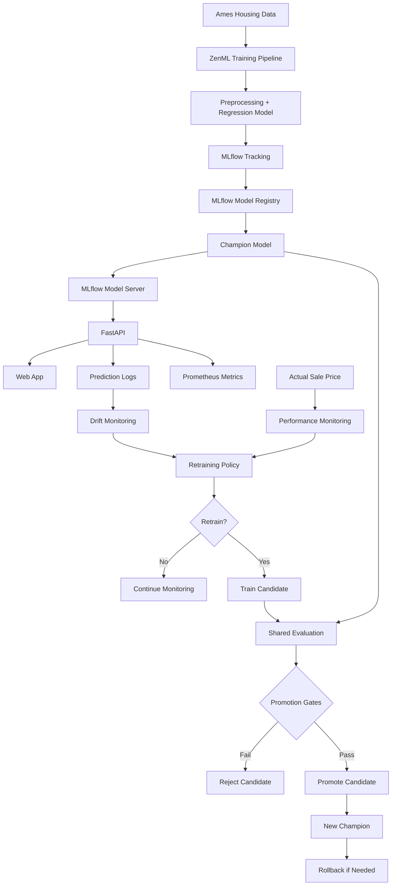

# End-to-End House Price Prediction & MLOps System

A production-oriented machine learning project built around the **Ames Housing** dataset.

The goal is not only to train a regression model, but to demonstrate the full ML lifecycle:

**train → track → serve → monitor → collect feedback → retrain → evaluate → promote → rollback**

## Business View

The system estimates a property's sale price from housing features and then keeps track of whether the model remains reliable after deployment.

Current champion baseline:

| Metric | Result |
|---|---:|
| MAE | **$13,044.81** |
| RMSE | **$18,626.84** |
| R² | **0.9221** |

In practical terms, the model's average absolute error on the test set is about **$13K**, while explaining about **92.2% of the variance** in sale prices.

The web app now contains two views:

- **Business Overview** — plain-language project summary and the house-price prediction interface.
- **Technical Overview** — architecture, monitoring, retraining, model promotion, rollback, and live system status.

## Architecture



## What the Project Includes

| Area | Implementation |
|---|---|
| ML pipeline | ZenML |
| Model | scikit-learn Linear Regression pipeline |
| Experiment tracking | MLflow |
| Model registry | MLflow Model Registry |
| Serving | MLflow model server + FastAPI |
| Validation | Pydantic |
| Frontend | HTML, CSS, JavaScript |
| Containerization | Docker |
| Operational metrics | Prometheus-compatible endpoint |
| Drift monitoring | PSI on recent production traffic |
| Performance monitoring | MAE, RMSE, R² + business error bands |
| Retraining | Policy-driven candidate training |
| Promotion | Champion/candidate quality gates |
| Rollback | Previous champion alias |
| CI | GitHub Actions |
| Automated tests | **28 tests** |

## Production ML Lifecycle

The monitoring system uses:

- the latest **100 predictions** for drift analysis;
- the latest **50 labelled outcomes** for performance monitoring;
- at least **30 labelled examples** before retraining can be recommended;
- actual performance degradation as the primary retraining signal;
- drift as supporting evidence rather than an automatic retraining trigger.

Candidate promotion requires:

- at least **1% MAE improvement**;
- no more than **2% RMSE degradation**;
- no more than **0.005 R² drop**.

The current champion is stored through the MLflow `champion` alias. Before promotion, the old model is preserved as `previous_champion` so it can be restored through rollback.

## Main API Endpoints

| Method | Endpoint | Purpose |
|---|---|---|
| GET | `/app` | Web application |
| POST | `/predict` | House-price prediction |
| POST | `/actual` | Submit delayed ground truth |
| GET | `/health` | API health |
| GET | `/metrics` | Prometheus metrics |
| GET | `/drift` | Drift report |
| GET | `/performance` | Production performance |
| POST | `/retraining/lifecycle` | Run retraining lifecycle |
| POST | `/promotion/registry` | Promote approved candidate |
| POST | `/rollback/registry` | Restore previous champion |

Interactive API documentation:

```text
http://127.0.0.1:8001/docs
```

## Run Locally

### 1. Install dependencies

Python 3.11 is recommended.

```bash
pip install -r requirements.txt
pip install -r requirements-api.txt
```

### 2. Train the model

```bash
python run_pipeline.py
```

### 3. Start the MLflow champion model

Set the same MLflow tracking URI used by the project, then run:

```bash
mlflow models serve \
  -m "models:/prices_predictor@champion" \
  -p 8000 \
  --no-conda
```

### 4. Start FastAPI

In another terminal:

```bash
python -m uvicorn api.main:app --reload --port 8001
```

Open:

```text
http://127.0.0.1:8001/app
```

## Docker

Build the API image:

```bash
docker build -t prices-predictor-api:latest .
```

With the MLflow model server running on the host:

```bash
docker run --rm \
  -p 8001:8001 \
  -e MLFLOW_MODEL_URL=http://host.docker.internal:8000/invocations \
  prices-predictor-api:latest
```

The Docker image packages the **FastAPI + frontend + monitoring layer**. ZenML remains the training/pipeline orchestration layer.

## Tests and CI

Run locally:

```bash
ruff check api monitoring tests
python -m pytest tests -v
```

GitHub Actions runs:

```text
Ruff
  ↓
28 automated tests
  ↓
Docker image build
```

## Current Limitations

This is a portfolio-grade local MLOps system, not a fully managed cloud production platform.

Important limitations:

- prediction and actual-label history is stored in local JSONL files;
- container-local monitoring data is not persistent without external storage;
- champion/candidate evaluation should eventually use a permanently untouched holdout or temporal evaluation window;
- changing the MLflow `champion` alias does not automatically hot-reload an already running model server;
- cloud infrastructure and remote MLflow storage are not deployed.

## Tech Stack

**Python · pandas · scikit-learn · ZenML · MLflow · FastAPI · Pydantic · Prometheus · Docker · GitHub Actions · pytest · Ruff**

---

**Harkamal Singh Toor**

Data Science · Machine Learning · MLOps
