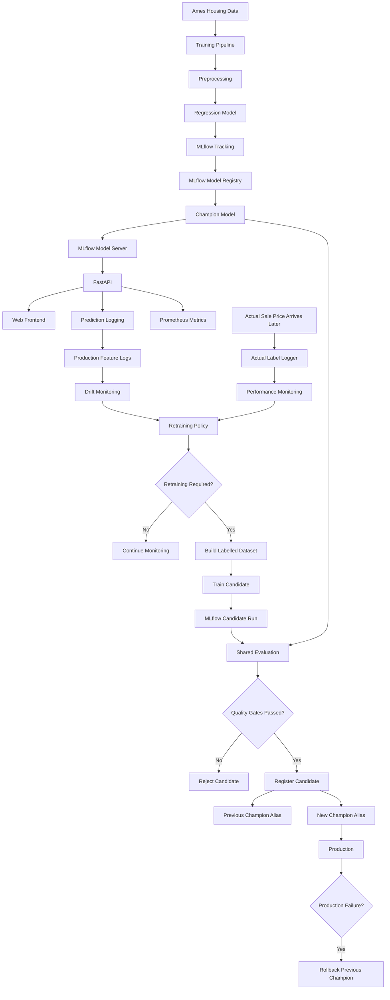

# End-to-End House Price Prediction & MLOps System

An end-to-end machine learning system for house price prediction that goes beyond model training and demonstrates the full ML lifecycle:

**data → training → experiment tracking → model registry → serving → monitoring → feedback → retraining → evaluation → promotion → rollback**

The project uses the Ames Housing dataset and focuses on building a production-oriented ML workflow with MLflow, FastAPI, Docker, Prometheus-style metrics, drift monitoring, automated retraining policy, model promotion gates, rollback support, automated tests, and GitHub Actions CI.

---

## Project Overview

Most machine learning projects stop after:

```text
Train model
    ↓
Evaluate model
    ↓
Save model
```

This project extends that into a complete operational lifecycle:

```text
Training Data
      ↓
Training Pipeline
      ↓
MLflow Experiment Tracking
      ↓
Model Registry
      ↓
Champion Model
      ↓
Model Serving
      ↓
FastAPI Prediction API
      ↓
Production Predictions
      ↓
Monitoring + Delayed Actual Labels
      ↓
Drift & Performance Monitoring
      ↓
Retraining Policy
      ↓
Candidate Training
      ↓
Champion vs Candidate Evaluation
      ↓
Promotion Decision
      ↓
Model Registry Update
      ↓
Rollback if required
```

The goal is not only to predict house prices, but to demonstrate how an ML model can be operated, monitored, evaluated, updated, and maintained after deployment.

---

# Key Results

The current champion regression model achieved approximately:

| Metric | Result |
|---|---:|
| MAE | **$13,044.81** |
| RMSE | **$18,626.84** |
| R² | **0.9221** |

### Interpretation

- The model explains roughly **92.2% of the variance** in house prices.
- Average absolute prediction error is approximately **$13K**.
- Larger prediction errors are reflected in the approximately **$18.6K RMSE**.

These metrics form the initial performance baseline used by the production monitoring system.

---

# System Architecture



---

# Main Components

## 1. Training Pipeline

The training workflow performs:

- data ingestion
- missing value handling
- preprocessing
- feature transformation
- train/test splitting
- regression model training
- evaluation
- experiment logging

The model owns important preprocessing logic so that training and inference use the same transformations.

For example:

- `Gr Liv Area` uses a log transformation
- `SalePrice` uses a log-transformed target through `TransformedTargetRegressor`
- missing numeric values are handled within the pipeline

This reduces the risk of training-serving skew.

---

# 2. MLflow Experiment Tracking

MLflow is used to record:

- training parameters
- evaluation metrics
- model artifacts
- experiment runs
- retraining candidates

Example tracked metrics include:

```text
train_mae
train_rmse
train_r2

test_mae
test_rmse
test_r2
```

Each retrained candidate receives its own MLflow run ID.

---

# 3. MLflow Model Registry

The project uses MLflow Model Registry to manage model versions.

The production model is represented using the alias:

```text
champion
```

During promotion:

```text
Old champion
     ↓
previous_champion

Candidate
     ↓
champion
```

This provides a clear model lineage and creates a rollback target.

---

# 4. Model Serving

The trained model is served through an MLflow model server.

FastAPI acts as the production-facing application layer.

```text
Client
  ↓
FastAPI
  ↓
MLflow Model Server
  ↓
Prediction
```

The MLflow model server typically runs on:

```text
localhost:8000
```

FastAPI runs on:

```text
localhost:8001
```

---

# 5. FastAPI Prediction Service

The main prediction endpoint is:

```text
POST /predict
```

The API:

1. validates incoming features
2. converts them into the model's expected schema
3. sends the request to the MLflow model server
4. receives the prediction
5. logs the prediction and feature snapshot
6. returns a formatted result

Example response:

```json
{
  "status": "success",
  "predicted_price": 190330.71,
  "currency": "USD"
}
```

---

# 6. Input Validation

Pydantic models validate incoming house features before inference.

Examples include:

```text
Overall Qual: 1–10

Month Sold: 1–12

Year Built: validated range

Living Area: > 0

Lot Area: > 0
```

Invalid requests return HTTP validation errors before reaching the model.

---

# 7. Web Frontend

A lightweight frontend is included under:

```text
frontend/
```

The application is available through:

```text
GET /app
```

It sends house features to FastAPI and displays the predicted house price.

The frontend is intentionally lightweight so the project remains focused on ML system architecture rather than frontend engineering.

---

# 8. Structured Request Logging

Every API request receives a unique request ID:

```text
UUID
```

Example:

```text
request_started
request_id=b6c51218-e55a-4f4b-a544-c40471c8a204
method=POST
path=/predict
```

The API also records:

- HTTP method
- route
- status code
- latency
- failures

The request ID connects predictions with future actual outcomes.

---

# 9. Prometheus Metrics

The application exposes:

```text
GET /metrics
```

Metrics include:

```text
http_requests_total
http_request_duration_seconds
prediction_requests_total
prediction_errors_total
```

Example:

```text
http_requests_total{
    method="POST",
    path="/predict",
    status="200"
}
```

These metrics make the application compatible with Prometheus/Grafana-style monitoring stacks.

---

# 10. Prediction Logging

Production predictions are logged as JSONL.

Example:

```json
{
  "timestamp": "2026-09-02T05:15:27+00:00",
  "request_id": "b6c51218-e55a-4f4b-a544-c40471c8a204",
  "model_name": "prices_predictor",
  "features": {
    "Lot Area": 9600,
    "Overall Qual": 5,
    "Year Built": 1961,
    "Gr Liv Area": 1710,
    "Bedroom AbvGr": 3,
    "Garage Cars": 2
  },
  "prediction": 190330.71
}
```

The full inference feature vector is retained so future labelled examples can be reconstructed for retraining.

Runtime logs are excluded from Git.

---

# 11. Delayed Ground-Truth Feedback

In many real systems, the true outcome is not known when a prediction is made.

For house prices:

```text
Prediction today
      ↓
Actual sale happens later
      ↓
Actual sale price becomes available
```

The system handles this through:

```text
POST /actual
```

Example:

```json
{
  "request_id": "b6c51218-e55a-4f4b-a544-c40471c8a204",
  "actual_price": 195000
}
```

The request ID joins the prediction with its eventual ground truth.

---

# 12. Performance Monitoring

Production model performance is available through:

```text
GET /performance
```

The monitor calculates:

- MAE
- RMSE
- R²
- percentage of predictions within $10K
- percentage within $20K
- percentage within $40K
- average overprediction
- average underprediction
- MAE degradation relative to baseline

A minimum number of labelled examples is required before performance conclusions are made.

Current threshold:

```text
minimum labelled samples = 10
```

Before that:

```json
{
  "status": "insufficient_data"
}
```

---

# 13. Rolling Performance Window

Production performance is calculated using the most recent:

```text
50 labelled outcomes
```

rather than all historical predictions forever.

This makes monitoring more sensitive to recent model degradation.

```text
Latest 50 labels
      ↓
MAE / RMSE / R²
      ↓
Current production health
```

---

# 14. Data Drift Monitoring

Drift monitoring currently tracks:

```text
Lot Area
Overall Qual
Year Built
Gr Liv Area
Bedroom AbvGr
Garage Cars
```

The system uses Population Stability Index:

```text
PSI
```

General interpretation:

```text
PSI < 0.10
→ no significant drift

0.10 ≤ PSI < 0.25
→ moderate drift

PSI ≥ 0.25
→ significant drift
```

The API exposes:

```text
GET /drift
```

---

# 15. Rolling Drift Window

Drift detection uses the most recent:

```text
100 prediction records
```

instead of the complete history.

This allows recent changes in production traffic to become visible more quickly.

---

# 16. Portable Drift Reference Profile

The production container does not need the complete Ames Housing dataset.

Instead, an offline reference profile is generated from the training distribution:

```text
AmesHousing.csv
      ↓
build_reference_profile.py
      ↓
reference_profile.json
```

The profile contains:

- reference means
- quantile bin edges
- expected feature distributions

Docker only needs:

```text
monitoring/reference_profile.json
```

This avoids embedding the complete raw training dataset inside the production API image.

Generate the profile with:

```bash
python -m monitoring.build_reference_profile
```

---

# 17. Retraining Policy

Model retraining is not triggered automatically just because drift exists.

The policy considers:

```text
label availability
+
production performance
+
drift evidence
```

Current minimum labelled sample requirement:

```text
30
```

Example decision:

```json
{
  "retrain_recommended": false,
  "decision": "wait_for_more_labels"
}
```

This prevents retraining based on weak evidence.

### Important policy principle

```text
Drift alone ≠ retraining
```

The current implementation requires sufficient labelled production data and actual performance degradation before recommending retraining.

---

# 18. Retraining Dataset Construction

Prediction logs contain:

```text
request_id
features
prediction
```

Actual logs contain:

```text
request_id
actual_price
```

The system joins them:

```text
predictions.jsonl
        +
actuals.jsonl
        ↓
join on request_id
        ↓
labelled production dataset
```

The true sale price becomes:

```text
SalePrice
```

for candidate training.

---

# 19. Candidate Model Training

When the retraining policy authorizes retraining:

```text
Production labelled data
        ↓
Train/test split
        ↓
Candidate model
        ↓
MLflow run
```

Candidate metrics are logged to MLflow.

A retraining attempt is blocked if fewer than:

```text
30 labelled production rows
```

are available.

---

# 20. Shared Champion vs Candidate Evaluation

The system supports evaluating both models against the same labelled production dataset.

```text
Same evaluation data
       ↓
Champion
       +
Candidate
       ↓
MAE / RMSE / R²
       ↓
Promotion gates
```

This is more meaningful than directly comparing metrics produced from unrelated historical test sets.

### Current limitation

The candidate training data and production evaluation data originate from the same growing labelled-production dataset.

A stricter production implementation should maintain a **persistent untouched evaluation holdout** so no candidate has trained on examples later used for final promotion decisions.

This is listed as a future hardening improvement.

---

# 21. Model Promotion Gates

A candidate must satisfy multiple quality conditions.

Current thresholds:

```text
Minimum MAE improvement:
1%

Maximum allowed RMSE degradation:
2%

Maximum allowed R² drop:
0.005
```

Example:

```text
Candidate MAE improves substantially  ✅
RMSE remains acceptable               ✅
R² remains acceptable                 ✅
-----------------------------------------
Promote candidate                      ✅
```

A candidate failing any required gate is rejected.

---

# 22. Model Promotion

The production promotion endpoint is:

```text
POST /promotion/registry
```

The process:

```text
Candidate MLflow Run
        ↓
Get current champion
        ↓
Shared evaluation
        ↓
Quality gates
        ↓
PASS?
   ↓
Register candidate
        ↓
old champion → previous_champion
candidate    → champion
```

Promotion is separated from simple evaluation so the system can distinguish between:

```text
Should this model be promoted?
```

and:

```text
Actually mutate the production registry
```

---

# 23. Rollback

Rollback support is available through:

```text
POST /rollback/registry
```

Before promotion:

```text
Version 1
alias = champion
```

After promotion:

```text
Version 1
alias = previous_champion

Version 2
alias = champion
```

If the new model causes problems:

```text
Version 2
      ↓
rolled_back

Version 1
      ↓
champion
```

This creates a simple but practical model recovery mechanism.

---

# 24. Automated Retraining Lifecycle

The project includes an orchestrated lifecycle:

```text
Production monitoring
        ↓
Retraining policy
        ↓
Candidate training
        ↓
MLflow candidate
        ↓
Shared evaluation
        ↓
Promotion recommendation
        ↓
Registry promotion
```

The full lifecycle can be triggered through:

```text
POST /retraining/lifecycle
```

With insufficient labelled data, the workflow safely stops:

```json
{
  "lifecycle_completed": false,
  "promoted": false,
  "decision": "wait_for_more_labels"
}
```

---

# API Endpoints

| Method | Endpoint | Purpose |
|---|---|---|
| GET | `/` | API information |
| GET | `/health` | Health check |
| GET | `/model-info` | Model metadata |
| GET | `/app` | Web frontend |
| POST | `/predict` | Generate prediction |
| POST | `/actual` | Submit delayed ground truth |
| GET | `/metrics` | Prometheus metrics |
| GET | `/drift` | Feature drift report |
| GET | `/performance` | Production performance |
| POST | `/promotion-check` | Diagnostic metric comparison |
| POST | `/promotion-check/mlflow` | Compare candidate MLflow run |
| POST | `/promotion-check/mlflow-runs` | Compare two MLflow runs |
| POST | `/promotion-check/registry` | Shared production evaluation |
| POST | `/promotion/registry` | Promote approved candidate |
| POST | `/rollback/registry` | Restore previous champion |
| POST | `/retraining/run` | Run retraining controller |
| POST | `/retraining/lifecycle` | Run full retraining lifecycle |

Interactive API documentation is available at:

```text
http://127.0.0.1:8001/docs
```

---

# Automated Testing

The project currently includes:

```text
24 automated tests
```

Tests cover:

- API health
- model metadata
- successful predictions
- invalid feature ranges
- missing fields
- incorrect data types
- MLflow server failures
- MLflow timeout handling
- outgoing prediction payload
- prediction positivity
- retraining guard behavior
- promotion rejection
- insufficient evaluation data
- promotion quality gates
- retraining policy
- rolling drift windows
- rolling performance windows

Run:

```bash
python -m pytest tests -v
```

---

# Code Quality

Ruff is used for linting:

```bash
ruff check api monitoring tests
```

The CI pipeline rejects code that does not pass linting.

---

# Continuous Integration

GitHub Actions automatically runs on:

```text
push to main
pull request into main
manual workflow dispatch
```

The pipeline performs:

```text
Checkout
   ↓
Python 3.11 setup
   ↓
Install dependencies
   ↓
Ruff
   ↓
Automated tests
   ↓
Docker image build
```

A pull request should only be merged after:

```text
Run Tests          ✅
Build Docker Image ✅
```

---

# Docker

Build the API image:

```bash
docker build -t prices-predictor-api:latest .
```

Run the model server separately on port `8000`.

Then run the API container:

```bash
docker run --rm \
  -p 8001:8001 \
  -e MLFLOW_MODEL_URL=http://host.docker.internal:8000/invocations \
  prices-predictor-api:latest
```

Verify:

```text
http://127.0.0.1:8001/health
```

Expected:

```json
{
  "status": "healthy"
}
```

---

# Docker Architecture

```text
Mac / Host
│
├── MLflow Model Server
│       port 8000
│
└── Docker
        │
        └── FastAPI
             port 8001
                 │
                 └── host.docker.internal:8000
```

The Dockerized FastAPI service was validated against the MLflow model server and produced the expected prediction:

```text
$190,330.71
```

for the reference test request.

---

# Local Installation

## 1. Clone the repository

```bash
git clone <repository-url>

cd prices-predictor-system
```

---

## 2. Create a Python environment

Python 3.11 is recommended.

Using Conda:

```bash
conda create -n prices_ml python=3.11
conda activate prices_ml
```

---

## 3. Install dependencies

For the API/monitoring stack:

```bash
pip install -r requirements-api.txt
```

For the complete training environment:

```bash
pip install -r requirements.txt
```

---

# MLflow Configuration

Set the MLflow tracking URI for your environment.

Example:

```bash
export MLFLOW_TRACKING_URI="file:/absolute/path/to/mlruns"
```

Do not hard-code machine-specific tracking paths into source code.

---

# Start the MLflow Model Server

A registered champion model can be served through MLflow.

Example:

```bash
mlflow models serve \
  -m "models:/prices_predictor@champion" \
  -p 8000 \
  --no-conda
```

Alternatively, a specific MLflow run can be served during development.

---

# Start FastAPI

```bash
python -m uvicorn api.main:app \
  --host 0.0.0.0 \
  --port 8001
```

Open:

```text
http://127.0.0.1:8001/docs
```

---

# Example Prediction Request

```json
{
  "Order": 1,
  "PID": 5286,
  "MS SubClass": 20,
  "Lot Frontage": 80,
  "Lot Area": 9600,
  "Overall Qual": 5,
  "Overall Cond": 7,
  "Year Built": 1961,
  "Year Remod/Add": 1961,
  "Mas Vnr Area": 0,
  "BsmtFin SF 1": 700,
  "BsmtFin SF 2": 0,
  "Bsmt Unf SF": 150,
  "Total Bsmt SF": 850,
  "1st Flr SF": 856,
  "2nd Flr SF": 854,
  "Low Qual Fin SF": 0,
  "Gr Liv Area": 1710,
  "Bsmt Full Bath": 1,
  "Bsmt Half Bath": 0,
  "Full Bath": 1,
  "Half Bath": 0,
  "Bedroom AbvGr": 3,
  "Kitchen AbvGr": 1,
  "TotRms AbvGrd": 7,
  "Fireplaces": 2,
  "Garage Yr Blt": 1961,
  "Garage Cars": 2,
  "Garage Area": 500,
  "Wood Deck SF": 210,
  "Open Porch SF": 0,
  "Enclosed Porch": 0,
  "3Ssn Porch": 0,
  "Screen Porch": 0,
  "Pool Area": 0,
  "Misc Val": 0,
  "Mo Sold": 5,
  "Yr Sold": 2010
}
```

Example response:

```json
{
  "status": "success",
  "predicted_price": 190330.71,
  "currency": "USD"
}
```

---

# Project Structure

```text
prices-predictor-system/
│
├── .github/
│   └── workflows/
│       └── ci.yml
│
├── analysis/
│
├── api/
│   └── main.py
│
├── frontend/
│   ├── index.html
│   ├── script.js
│   └── style.css
│
├── monitoring/
│   ├── actuals_logger.py
│   ├── build_reference_profile.py
│   ├── candidate_training.py
│   ├── drift_monitor.py
│   ├── mlflow_candidate.py
│   ├── model_promotion.py
│   ├── model_registry.py
│   ├── performance_monitor.py
│   ├── prediction_logger.py
│   ├── reference_profile.json
│   ├── retraining_dataset.py
│   ├── retraining_evaluator.py
│   ├── retraining_lifecycle.py
│   ├── retraining_orchestrator.py
│   ├── retraining_policy.py
│   └── shared_evaluation.py
│
├── pipelines/
│   ├── deployment_pipeline.py
│   └── training_pipeline.py
│
├── src/
│
├── steps/
│
├── tests/
│   ├── test_api.py
│   └── test_monitoring.py
│
├── Dockerfile
├── requirements-api.txt
├── requirements.txt
└── README.md
```

---

# Reliability Features

The system includes several protections that are often missing from ML portfolio projects:

### Input validation

Bad requests are rejected before inference.

### Model server failure handling

```text
Connection failure → HTTP 503
Timeout            → HTTP 504
Service error      → HTTP 502
```

### Minimum monitoring sample sizes

The system avoids making decisions on tiny samples.

### Retraining policy gate

Candidate training is not triggered simply because drift exists.

### Promotion quality gates

A new model must outperform the champion sufficiently.

### Model versioning

Models are retained in MLflow Registry.

### Previous champion preservation

Rollback remains possible after promotion.

### Automated testing

Important lifecycle behavior is covered by tests.

### CI validation

Every major change is automatically linted, tested, and Docker-built.

---

# Current Limitations

This project intentionally focuses on demonstrating ML system architecture locally.

Several components would be upgraded before operating at high production scale.

## Local JSONL storage

Prediction and actual-label logs currently use JSONL.

A production deployment would normally use:

```text
PostgreSQL
data warehouse
object storage
streaming platform
feature store
```

depending on scale.

---

## Container storage is ephemeral

Monitoring logs written inside a Docker container disappear when the container is removed unless external storage or a volume is configured.

A production deployment should use persistent external storage.

---

## MLflow backend

The development system uses a local MLflow setup.

Production would normally use:

- remote tracking server
- SQL backend store
- object-storage artifact store

---

## Shared evaluation holdout

Champion and candidate comparison currently uses labelled production data.

A stronger production implementation would maintain an untouched evaluation dataset that candidate training cannot access.

---

## Feature set

The current model primarily uses numerical Ames features.

Future work could improve predictive performance by incorporating additional categorical variables.

---

## Identifier features

Features such as:

```text
Order
PID
```

should be reviewed and potentially removed in a future model version because identifiers may not provide meaningful generalizable signal.

---

## Drift test traffic

Current local drift reports may show severe drift because development traffic contains repeated manually generated test requests.

Those values should not be interpreted as real production drift.

---

# Future Improvements

Potential next steps include:

- persistent production database
- remote MLflow server
- cloud object storage
- scheduled retraining
- persistent evaluation holdout
- data quality monitoring
- schema evolution checks
- Grafana dashboards
- alerting
- model explainability
- SHAP analysis
- canary deployment
- shadow deployment
- automated rollback triggers
- cloud deployment
- Kubernetes orchestration
- stronger categorical feature engineering
- gradient boosting candidate models
- authenticated administrative endpoints

---

# Cloud Deployment Status

The project is currently designed to be **deployment-ready**, but no paid cloud infrastructure is required to run the portfolio project.

Current deployment layer:

```text
Docker
+
environment-variable configuration
+
GitHub Actions CI
```

Possible future deployment targets include:

```text
AWS ECS / EC2
Azure Container Apps
Google Cloud Run
Kubernetes
```

Cloud deployment is intentionally separated from the core ML lifecycle so the system can be developed and demonstrated locally without infrastructure cost.

---

# Engineering Decisions

Several design choices were intentional.

### Why FastAPI?

FastAPI provides:

- Pydantic validation
- automatic OpenAPI documentation
- lightweight inference endpoints
- clear separation between serving and model training

### Why MLflow?

MLflow handles:

- experiments
- run metadata
- metrics
- artifacts
- model registry
- model aliases

### Why Docker?

Docker provides reproducible API packaging and separates application dependencies from the host environment.

### Why delayed actual labels?

Real ML systems often receive outcomes after predictions. Modeling this feedback loop makes performance monitoring and retraining more realistic.

### Why not retrain on drift alone?

Feature drift does not automatically mean predictive performance has degraded. Retraining requires stronger evidence.

### Why maintain a previous champion?

A promoted model can fail after deployment even if offline metrics look better. Preserving the prior model provides a rollback mechanism.

---

# What This Project Demonstrates

This repository demonstrates practical experience across:

### Machine Learning

- regression
- preprocessing
- train/test evaluation
- feature transformations
- error metrics

### MLOps

- MLflow
- model registry
- candidate/champion lifecycle
- model versioning
- retraining
- promotion
- rollback

### Production ML

- inference APIs
- input validation
- prediction logging
- delayed labels
- drift monitoring
- performance monitoring
- operational metrics

### Software Engineering

- modular architecture
- automated tests
- error handling
- configuration through environment variables
- Docker
- Git/GitHub workflows

### DevOps

- CI
- Docker image validation
- pull-request checks
- linting
- automated test execution

---

# Final Workflow

```text
                    TRAINING
                       │
                       ▼
                Train Regression Model
                       │
                       ▼
                 MLflow Tracking
                       │
                       ▼
                Model Registry
                       │
                  champion alias
                       │
                       ▼
                    SERVING
                       │
          ┌────────────┴────────────┐
          ▼                         ▼
     MLflow Server               FastAPI
                                    │
                                    ▼
                               Predictions
                                    │
                          ┌─────────┴─────────┐
                          ▼                   ▼
                      Features            Request ID
                          │                   │
                          ▼                   ▼
                    Drift Monitor       Actual Price Later
                                              │
                                              ▼
                                      Performance Monitor
                                              │
                          ┌───────────────────┘
                          ▼
                    Retraining Policy
                          │
                    degradation?
                       /     \
                     no       yes
                     │         │
                     ▼         ▼
                 Monitor    Train Candidate
                               │
                               ▼
                           MLflow Run
                               │
                               ▼
                    Champion vs Candidate
                               │
                           Quality Gates
                           /           \
                        fail           pass
                         │               │
                         ▼               ▼
                      Reject          Promote
                                         │
                                         ▼
                                previous_champion
                                         │
                                         ▼
                                     Rollback
                                   if necessary
```

---

# Status

```text
Model training                    ✅
MLflow experiment tracking        ✅
FastAPI serving                   ✅
Web frontend                      ✅
Docker                            ✅
Structured logging               ✅
Prometheus metrics                ✅
Prediction logging               ✅
Delayed actual labels             ✅
Drift monitoring                  ✅
Rolling drift window              ✅
Performance monitoring            ✅
Rolling performance window        ✅
Retraining policy                 ✅
Candidate training                ✅
Shared evaluation                 ✅
MLflow Model Registry             ✅
Champion alias                    ✅
Model promotion                   ✅
Rollback                          ✅
Automated retraining lifecycle    ✅
Automated tests                   ✅
GitHub Actions CI                 ✅
Docker CI validation              ✅
Cloud deployment                  Planned
```

---

# Author

**Harkamal Singh Toor**

Data Science • Machine Learning • MLOps

---

## Project Goal

The main objective of this project is not to build the most complex house-price model possible.

The objective is to demonstrate how a machine learning model becomes a **maintainable software system**:

> Train it, track it, serve it, monitor it, detect degradation, collect ground truth, retrain safely, compare models, promote better versions, and recover when necessary.