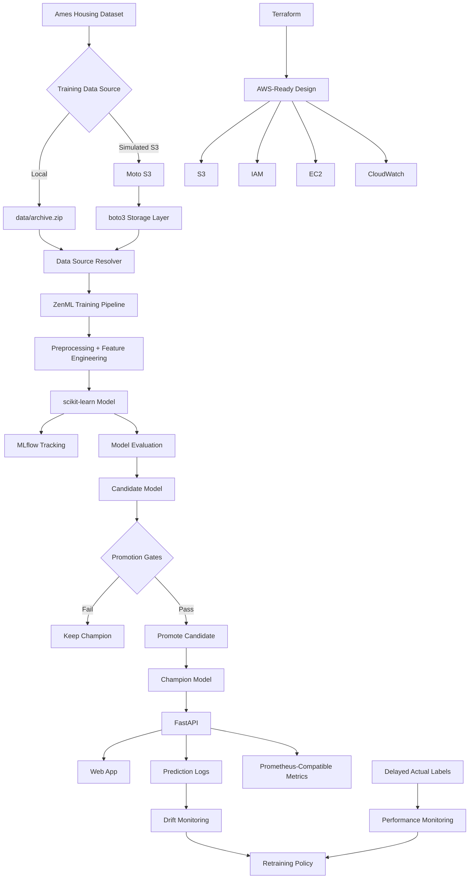

# End-to-End House Price ML & MLOps — AWS-Ready / Locally Simulated

A production-oriented machine learning project built on the **Ames Housing** dataset.

This repository demonstrates the full ML lifecycle:

**ingest → train → track → evaluate → serve → monitor → retrain → promote → rollback**

It also adds an **AWS-oriented infrastructure layer** using **boto3, Moto, IAM design, EC2 architecture, CloudWatch concepts, and Terraform** while remaining fully local and zero-cost.

> **Status: AWS-Ready / Locally Simulated**
>
> This repository does **not** provision or deploy real AWS resources.

## Business View

The model predicts residential sale prices from housing features.

Current champion baseline:

| Metric | Result |
|---|---:|
| MAE | **$13,044.81** |
| RMSE | **$18,626.84** |
| R² | **0.9221** |

In practical terms, the model's average absolute error is about **$13K**, while explaining about **92.2% of the variance** in sale prices on the evaluation set.

## What This Project Demonstrates

| Area | Implementation |
|---|---|
| Data ingestion | Local ZIP or simulated S3 |
| ML pipeline | ZenML |
| Model | scikit-learn regression pipeline |
| Experiment tracking | MLflow |
| Model registry | MLflow Model Registry |
| Serving | MLflow model server + FastAPI |
| Validation | Pydantic |
| Frontend | HTML, CSS, JavaScript |
| Containerization | Docker |
| Operational metrics | Prometheus-compatible endpoint |
| Drift monitoring | PSI |
| Performance monitoring | MAE, RMSE, R² |
| Retraining | Policy-driven candidate training |
| Promotion | Champion/candidate quality gates |
| Rollback | Previous champion support |
| Local AWS simulation | Moto + boto3 |
| Infrastructure as Code | Terraform |
| Cloud design | S3, IAM, EC2, CloudWatch |
| CI | GitHub Actions |
| Testing | pytest |
| Linting | Ruff |

## Architecture



## Local vs AWS-Ready Design

The current implementation runs locally:

```text
Moto S3
   ↓
boto3
   ↓
ZenML
   ↓
scikit-learn
   ↓
MLflow
   ↓
FastAPI
   ↓
Docker / local monitoring
```

The Terraform configuration models how the same system could later map to AWS:

| Current Local Component | Future AWS Mapping |
|---|---|
| Moto S3 | Amazon S3 |
| boto3 | AWS SDK for Python |
| Local Docker runtime | EC2-hosted Docker |
| Local permissions | IAM Role + Instance Profile |
| Local logs / metrics | CloudWatch |
| Terraform validation | Terraform-managed AWS infrastructure |

The project intentionally does **not** claim that S3, IAM, EC2, or CloudWatch are currently deployed.

## Training Data Sources

The training pipeline supports two modes while keeping the downstream ML pipeline unchanged.

### Local mode

```bash
DATA_SOURCE=local python run_pipeline.py
```

Uses:

```text
data/archive.zip
```

### Simulated S3 mode

```bash
DATA_SOURCE=s3 python run_pipeline.py
```

Uses the locally simulated object:

```text
s3://ml-local-data/datasets/raw/archive.zip
```

The storage-specific logic is isolated in:

```text
aws_local/
├── config.py
├── data_source.py
├── s3_client.py
└── storage.py
```

This keeps S3 logic separate from model training code.

## Run Locally

Python **3.11** is recommended.

### 1. Install dependencies

```bash
pip install -r requirements.txt
pip install -r requirements-api.txt
pip install -r requirements-aws-local.txt
```

### 2. Activate the ZenML stack with MLflow

```bash
zenml stack set mlflow_stack
```

### 3. Train from the local dataset

```bash
DATA_SOURCE=local python run_pipeline.py
```

## Run With Local S3 Simulation

### 1. Start Moto

In one terminal:

```bash
moto_server -H 127.0.0.1 -p 5000
```

### 2. Set dummy local credentials

In another terminal:

```bash
export AWS_ACCESS_KEY_ID=test
export AWS_SECRET_ACCESS_KEY=test
export AWS_DEFAULT_REGION=us-east-1
export AWS_ENDPOINT_URL=http://127.0.0.1:5000
export AWS_EC2_METADATA_DISABLED=true
```

These are dummy values for the local simulator only.

### 3. Create the bucket and upload the dataset

```bash
python - <<'PY'
from aws_local.config import DATA_BUCKET
from aws_local.s3_client import get_s3_client

s3 = get_s3_client()

bucket_names = [
    bucket["Name"]
    for bucket in s3.list_buckets().get("Buckets", [])
]

if DATA_BUCKET not in bucket_names:
    s3.create_bucket(Bucket=DATA_BUCKET)

s3.upload_file(
    "data/archive.zip",
    DATA_BUCKET,
    "datasets/raw/archive.zip",
)

print(f"Uploaded s3://{DATA_BUCKET}/datasets/raw/archive.zip")
PY
```

### 4. Train through the simulated S3 path

```bash
DATA_SOURCE=s3 python run_pipeline.py
```

## AWS Safety Boundary

The AWS-learning code is intentionally constrained to local simulation.

The project uses:

- dummy credentials only;
- a localhost Moto endpoint;
- endpoint validation before creating the boto3 client;
- no `aws configure`;
- no AWS account requirement;
- no payment method;
- no real AWS provisioning.

The client allows approved local hosts such as:

```text
127.0.0.1
localhost
```

This prevents the learning path from accidentally targeting a real S3 endpoint.

## IAM Design

The Terraform configuration demonstrates **least privilege**.

The future compute service would be allowed to:

- list the ML S3 bucket;
- read and write under `datasets/*`;
- read and write under `models/*`.

The intended identity flow is:

```text
EC2
 ↓
IAM Instance Profile
 ↓
IAM Role
 ↓
Least-Privilege S3 Policy
 ↓
datasets/* + models/*
```

This avoids storing long-lived AWS access keys inside the application.

## Terraform

Terraform files are located in:

```text
infrastructure/terraform/
```

The configuration models:

```text
Amazon S3
AWS IAM
Amazon EC2
Amazon CloudWatch
```

Safe commands used in this project:

```bash
cd infrastructure/terraform

terraform init -backend=false
terraform fmt -recursive
terraform validate
```

The project intentionally does **not** run:

```bash
terraform plan
terraform apply
terraform destroy
```

No real AWS infrastructure is created.

## Production ML Lifecycle

The system follows:

```text
Training
   ↓
MLflow Tracking
   ↓
Evaluation
   ↓
Candidate Model
   ↓
Promotion Gates
   ├── Fail → Keep Champion
   └── Pass → Promote Candidate
                    ↓
                FastAPI
                    ↓
              Predictions
                    ↓
               Monitoring
                    ↓
            Retraining Policy
```

Candidate promotion requires:

- at least **1% MAE improvement**;
- no more than **2% RMSE degradation**;
- no more than **0.005 R² drop**.

The previous champion can be preserved for rollback.

## Monitoring

The existing local monitoring layer includes:

- prediction logging;
- Prometheus-compatible operational metrics;
- PSI feature drift monitoring;
- delayed actual labels;
- MAE, RMSE, and R² performance monitoring;
- retraining recommendations.

CloudWatch in the Terraform design represents a future **infrastructure and application observability layer**. It does not replace ML-specific drift or model-performance monitoring.

## Main API Endpoints

| Method | Endpoint | Purpose |
|---|---|---|
| GET | `/app` | Web application |
| POST | `/predict` | House-price prediction |
| POST | `/actual` | Submit delayed ground truth |
| GET | `/health` | API health |
| GET | `/metrics` | Prometheus-compatible metrics |
| GET | `/drift` | Drift report |
| GET | `/performance` | Production performance |
| POST | `/retraining/lifecycle` | Run retraining lifecycle |
| POST | `/promotion/registry` | Promote approved candidate |
| POST | `/rollback/registry` | Restore previous champion |

Interactive API documentation:

```text
http://127.0.0.1:8001/docs
```

## Start the Prediction Service

Start the MLflow champion model:

```bash
mlflow models serve \
  -m "models:/prices_predictor@champion" \
  -p 8000 \
  --no-conda
```

Then start FastAPI:

```bash
python -m uvicorn api.main:app --reload --port 8001
```

Open:

```text
http://127.0.0.1:8001/app
```

## Docker

Build the API image:

```bash
docker build -t prices-predictor-api:latest .
```

With the MLflow model server running on the host:

```bash
docker run --rm \
  -p 8001:8001 \
  -e MLFLOW_MODEL_URL=http://host.docker.internal:8000/invocations \
  prices-predictor-api:latest
```

The Docker image packages the FastAPI, frontend, monitoring, and deployment runtime components.

## Tests and CI

Run locally:

```bash
ruff check api monitoring aws_local tests
python -m pytest tests -v
```

The test suite includes API, monitoring, endpoint-safety, and simulated-S3 coverage.

GitHub Actions runs:

```text
Install dependencies
        ↓
Ruff
        ↓
pytest
        ↓
Docker image build
```

CI does not require real AWS credentials.

## Current Limitations

This is a portfolio-grade local MLOps system, not a fully managed AWS production platform.

Current limitations include:

- S3 is simulated using Moto;
- EC2, IAM, S3, and CloudWatch are not provisioned;
- Terraform is validation-only;
- prediction and actual-label history is stored locally;
- container-local monitoring state is not durable without external persistence;
- the MLflow registry remains locally managed;
- HTTPS, load balancing, autoscaling, managed secrets, and production networking are outside the current scope.

## Project Goal

The purpose of this repository is to demonstrate the engineering progression:

```text
Local ML project
      ↓
Reproducible ML pipeline
      ↓
MLOps lifecycle
      ↓
Containerized inference
      ↓
S3-compatible storage abstraction
      ↓
Least-privilege cloud design
      ↓
Infrastructure as Code
```

while keeping the entire AWS learning environment **safe, local, and zero-cost**.

## Tech Stack

**Python · pandas · scikit-learn · ZenML · MLflow · FastAPI · Pydantic · boto3 · Moto · Terraform · Docker · Prometheus · GitHub Actions · pytest · Ruff**

---

**Harkamal Singh Toor**

Data Science · Machine Learning · MLOps
